 

 

<table>
<tr>
<td width="60%" valign="top">

### &nbsp;👋&nbsp; About Me

- 🎓 B.Tech Computer Science & Engineering at **VIT Bhopal** (2023–2027), open to **SDE / AI-ML roles** for 2027
- 🧠 I build **computer-vision pipelines**, **LLM-agent workflows** and **Python backends** (FastAPI, Flask)
- 🛰️ I like end-to-end systems: sensors and models at one end, APIs, dashboards and tests at the other
- 🌱 Currently deepening: edge AI, BIM/CAD automation and production-grade backend engineering
- 💬 Philosophy: *ship it, then make it beautiful*

</td>
<td width="40%" valign="top">

</td>
</tr>
</table>

### &nbsp;💼&nbsp; Experience

| Role | Where | What I work on |
|---|---|---|
| **Software Development Intern**, FOSSEE Autumn Internship *(Sep 2026 – present, remote)* | **FOSSEE, IIT Bombay** · Osdag | Parametric 3D CAD geometry for the open-source bridge-design module with Python and pythonOCC/OpenCASCADE, and IFC4 (BIM) export of substructure elements |
| **Python AI/ML Developer Intern** *(May 2025 – present)* | **Travarsa Private Limited**, Kolkata | LLM agents with LangChain, LangGraph and LangSmith; computer-vision pipelines with Python and OpenCV; internal-tool frontend modules |

### &nbsp;🚀&nbsp; Featured Projects

| Project | What it is | Stack |
|---|---|---|
| 🎯 [**Shortlist**](https://github.com/Ryzuuuu/Shortlist) | AI-assisted CV screening for a staffing firm plus a mobile-first client shortlist portal. The LLM only returns per-criterion evidence; **code computes the score**, every quote is **verified against the CV**, personal details are redacted before the model sees them, and the AI never auto-rejects. DPDP-Act-aware. | Next.js · TypeScript · Postgres · Drizzle |
| 🏬 [**StoreSight**](https://github.com/Ryzuuuu/StoreSight) | Turns CCTV footage into store analytics: customer journeys, funnels, zone heatmaps and anomaly detection, served through a FastAPI service. | YOLOv8 · ByteTrack · Re-ID · FastAPI · Docker |
| 🧿 [**TriSense**](https://github.com/Ryzuuuu/TriSense) | Raspberry Pi assistive platform with three offline modes: ultrasonic spatial haptics (blind), Vosk speech subtitles on an OLED (deaf), 3D sign-language recognition (mute). | PyTorch 1D-CNN+GRU · MediaPipe · Vosk |
| ✈️ [**AeroSense Edge**](https://github.com/Ryzuuuu/AeroSenseEdge) | Edge-AI fuel and emissions advisory prototype: OpenAP-simulated A320 flights, LightGBM fuel-burn predictor, descent and APU advisors, live dashboard. | FastAPI · LightGBM · OpenAP · React |
| 🌉 [**ParaBridge**](https://github.com/Ryzuuuu/ParaBridge) | Parametric 3D CAD generator for steel girder bridges with STEP export and an interactive viewer, built for the FOSSEE Osdag bridge module. | pythonOCC · Python |
| 🧠 [**NeuroEcho**](https://github.com/Ryzuuuu/NeuroEcho) | Voice-biomarker screening prototype (jitter, shimmer, HNR) with a CNN + biomarker ensemble, FastAPI API and Docker Compose. A triage aid, not a diagnosis. | PyTorch · Librosa · FastAPI |
| 🤖 [**MemoryBot**](https://github.com/Ryzuuuu/MemoryBot) | Locally run Mistral-7B chatbot with five LangChain memory strategies, a FastAPI inference API and a Django + WebSocket chat UI. | LlamaCpp · FastAPI · Django · Redis |
| 🖐️ [**PresentoVision**](https://github.com/Ryzuuuu/PresentoVision) | Control any slide deck with hand gestures through YOLOv8n and MediaPipe. | OpenCV · MediaPipe · YOLOv8 |
| 🌾 [**Fasal Sahaayak**](https://github.com/Ryzuuuu/Fasal-Sahaayak) | Smart India Hackathon 2025 prototype: multilingual (EN/HI/OR) crop advisory with a Random Forest fertilizer recommender. | React · Flask · scikit-learn |
| 🎨 [**Portfolio**](https://ryzuuuu.github.io) | Interactive 3D portfolio with a retro console that reacts as you scroll. | React Three Fiber · Vite · Tailwind |

More: [FingerFall](https://github.com/Ryzuuuu/FingerFall) (hand-tracking game) · [NoteTouch](https://github.com/Ryzuuuu/NoteTouch) (gesture piano) · [InvisiCloak](https://github.com/Ryzuuuu/InvisiCloak) (invisible-portal effect) · [primetrade-assignment](https://github.com/Ryzuuuu/primetrade-assignment) (FastAPI + JWT + role-based task API)

### &nbsp;🛠️&nbsp; Tech Stack

 
 

**AI/ML:** computer vision, LLM agents (LangChain, LangGraph, LangSmith), scikit-learn, PyTorch · **Backend:** FastAPI, Flask, Django, REST, JWT, SQL · **Tools:** Docker, Git, pytest, CI/CD

### &nbsp;📊&nbsp; GitHub Analytics

  

### &nbsp;🏆&nbsp; Trophies

### &nbsp;🐍&nbsp; Contribution Snake

### &nbsp;🤝&nbsp; Let's connect

I'm looking for **2027 placement opportunities** in software engineering and AI/ML. If you're hiring, say hi.

