  

<table>
<tr>
<td width="60%" valign="top">

- 🎓 Student at **VIT Bhopal** (B.Tech CSE, batch of 2027), building across **AI/ML systems**, **web development**, and **competitive programming**
- 🌉 Interning at **FOSSEE, IIT Bombay** on **Osdag**: parametric 3D CAD and IFC4 (BIM) export for an open-source bridge-design tool
- 🧠 Python AI/ML developer intern at **Travarsa**: LLM agents (LangChain, LangGraph) and OpenCV computer-vision pipelines
- 🚀 Recent builds: **Shortlist** (AI CV screening), **StoreSight** (CCTV analytics), **TriSense** (offline assistive platform on Raspberry Pi) and **AeroSense Edge** (edge-AI fuel advisory prototype)
- 💬 Philosophy: *ship it, then make it beautiful*

</td>
<td width="40%" valign="top">

</td>
</tr>
</table>

  

  

